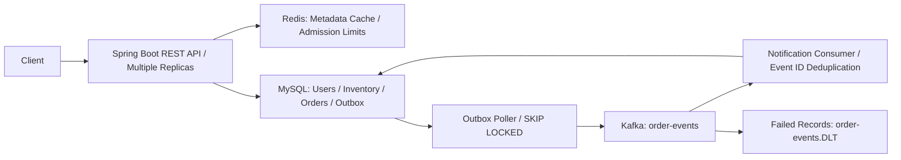

# Flash Sale Lab

A backend learning project for limited-stock sales. It covers concurrent ordering, inventory safety, request idempotency, order expiration, and reliable event delivery between MySQL and Kafka.

**Stack:** Java 17 · Spring Boot 3.5 · SQL / MySQL 8.4 · Redis 7.4 · Kafka 4.1 · Docker · Linux · Kubernetes · GitHub Actions

## Features

- Registration, login, and logout with BCrypt password hashing and random Bearer tokens. Only SHA-256 token hashes are stored; tokens expire after 24 hours.
- A product catalog with Redis metadata caching and SQL fallback. Inventory decisions always use the database.
- Atomic Redis Lua admission limits: 10 order attempts per user per 10 seconds by default. New orders return 503 if admission control is unavailable.
- Conditional SQL stock reservation, with inventory, orders, and Outbox events committed in one transaction.
- User-scoped `Idempotency-Key` support: identical retries return the existing order; different input with the same key returns 409.
- Simulated payment, cancellation, and expiration after 15 minutes, without duplicate inventory release.
- At-least-once Kafka delivery through a transactional Outbox, event-ID-based notification deduplication, consumer retries, and a dead-letter topic.
- Docker Compose, Kubernetes manifests with two API replicas and health probes, and GitHub Actions verification.

Payments are simulated. Notifications are stored in the database; no real payment provider, email service, or SMS gateway is connected.

## Quick Start

Install Docker Desktop with Linux containers, or Docker Engine with Compose on Linux. The first build downloads images and Maven dependencies.

```powershell
Copy-Item .env.example .env
docker compose up -d --build --wait
powershell -ExecutionPolicy Bypass -File scripts/smoke.ps1
```

On Linux or macOS, use `cp .env.example .env`, followed by the same Compose command. The smoke script requires PowerShell; Bash examples are available in the [API guide](docs/api.md).

Open `http://localhost:8080/api/products` to see two demo products. Compose enables the `demo` profile, which loads the sample catalog through Flyway. The default profile creates the schema without sample products.

Published ports bind to localhost only. The example credentials are for local development, and `.env` is ignored by Git.

```bash
docker compose ps
docker compose logs -f app
docker compose stop
```

Stopping preserves data. Removing named volumes deletes their MySQL orders or Kafka events.

## Development and Tests

Use JDK 17 or later and configure `JAVA_HOME` for your installation. Maven Wrapper is included.

```powershell
.\mvnw.cmd test
# Requires Docker: starts isolated MySQL, Redis, and Kafka containers on random ports.
.\mvnw.cmd verify -Dintegration=true
```

On Linux or macOS, run `./mvnw test` and `./mvnw verify -Dintegration=true`.

Fast tests use H2 for business transactions and API behavior. The integration flag enables real MySQL, Redis Lua, Kafka delivery, and dead-letter tests. CI explicitly enables them; unavailable Docker causes a failure rather than silently skipping middleware verification.

To run the application from an IDE or Maven with dependencies in Docker:

```powershell
docker compose up -d --wait mysql redis kafka
$env:DB_PASSWORD='local-demo-change-me' # Must match .env.
$env:SPRING_PROFILES_ACTIVE='demo'
.\mvnw.cmd spring-boot:run
```

| Concern | Verification |
|---|---|
| Overselling | 60 buyers / 20 units on H2; 40 buyers / 15 units on MySQL |
| Concurrent retries | 16 requests with one user/key create one order and one creation event |
| Transaction rollback | An injected Outbox failure rolls back both the order and stock reservation |
| Order lifecycle | Repeated payments/cancellations, expired payments, ownership checks |
| Redis | Real cache reads/writes, Lua admission limits, key expiration |
| Kafka | Real delivery, duplicate-event handling, poison-message routing to the DLT |
| Broker failure | Unacknowledged events are not marked as published |

See the [local verification record](docs/verification.md) for observed results and limits.

## Code Style and Lint

Spotless applies Google Java Format to production and test code, removes unused imports, and formats the Maven POM. Checkstyle checks explicit imports, required braces, one statement per line, naming conventions, and documentation for public types. Both checks run during Maven's `validate` phase, before compilation or tests, and are also required by CI.

```powershell
.\mvnw.cmd spotless:apply # Automatically format Java and pom.xml.
.\mvnw.cmd validate       # Check formatting and Java lint without running tests.
```

On Linux or macOS, use `./mvnw spotless:apply` and `./mvnw validate`. Formatter and linter versions are pinned in `pom.xml`; `.editorconfig` sets UTF-8, line endings, and indentation defaults. Java comments explain component responsibilities and the transaction, concurrency, and delivery guarantees in Chinese for learners.

## Architecture



This is a modular monolith. Each replica serves HTTP requests, polls the Outbox, and consumes Kafka events. SQL row locks and unique constraints coordinate instances; a Kafka consumer group distributes partitions. Inventory and authentication state are shared through the database.

Stock reservation uses `UPDATE products SET stock=stock-? WHERE id=? AND stock>=?`. Keeping the decision inside SQL gives inventory and order creation one transaction boundary. Redis stock pre-reservation would require extra reconciliation and compensation, so Redis is used for caching and admission control.

Order creation locks the user row before checking the idempotency key. Submissions from the same user are serialized. Different users compete for the product inventory row, which remains a throughput bottleneck for popular products. The project demonstrates correctness under contention; it does not claim production-scale throughput.

Outbox events are marked as published only after Kafka acknowledges them. A crash after acknowledgment but before SQL commit can cause redelivery. The notification table uses the event ID as its primary key to deduplicate database side effects. This provides at-least-once delivery, without claiming a global exactly-once transaction across MySQL and Kafka.

Supplemental guides, currently in Chinese:

- [Transactions, failure boundaries, and design tradeoffs](docs/architecture.md)
- [REST API reference and request examples](docs/api.md)
- [Linux operations, Kubernetes setup, and JVM diagnostics](docs/operations.md)

## Load Testing

With k6 installed, run the included scenario against a local demo instance:

```bash
k6 run load/flash-sale.js
# Supported variables: BUYERS, PRODUCT_ID, BASE_URL.
k6 run -e BUYERS=200 -e PRODUCT_ID=2 load/flash-sale.js
```

The script creates separate buyers before the rush. Each submits one order, then retries successful requests with the same key. It consumes demo inventory; existing orders affect the remaining stock.

Thresholds check business outcomes without assuming a request rate. Registration contributes to aggregate HTTP metrics, so filter by URL when analyzing order latency. Record hardware, concurrency, pool settings, error rates, and latency percentiles before comparing runs.

## Repository Layout

```text
src/main/java/dev/jzhope/flashsale/
  auth/       Accounts and Bearer tokens
  catalog/    Product catalog and cache
  order/      Inventory, idempotency, state transitions, expiration
  event/      Outbox, Kafka, notifications, dead-letter handling
  api/        Consistent error responses
src/main/resources/db/  Flyway migrations and demo catalog
src/test/              Fast tests and real middleware integration tests
deploy/k8s/            Local Kubernetes learning deployment
load/                  k6 concurrency scenario
scripts/               End-to-end smoke test
docs/                  API, architecture, operations, verification
```

## Deployment Limits

This project is for learning and local demonstrations. Internet-facing deployment needs TLS, login/registration abuse protection, secret management, middleware authentication, and network isolation.

The Kubernetes example runs single-node MySQL and Kafka, without production high availability. Its Redis is ephemeral: restarting clears the cache and short-lived admission counters, while SQL inventory remains intact.
