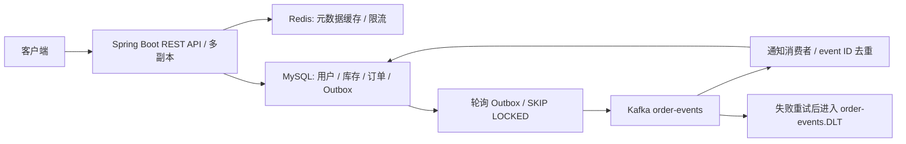

# Flash Sale Lab

一个面向后端学习和作品集展示的限量商品抢购系统。以真实业务问题组织技术：并发下单、防超卖、请求幂等、订单状态机、过期释放库存，以及数据库与 Kafka 之间的可靠事件投递。

Java 17 · Spring Boot 3.5 · SQL/MySQL 8.4 · Redis 7.4 · Kafka 4.1 · Docker · Linux · Kubernetes · GitHub Actions

## 实现范围

- 注册、登录、退出；BCrypt 密码散列，随机 Bearer token 仅以 SHA-256 摘要入库，24 小时过期。
- 商品目录；Redis 缓存商品元数据，缓存故障回源 SQL。库存不进缓存，也不依赖缓存做正确性判断。
- 用户维度 Redis Lua 固定窗口限流；默认 10 秒最多 10 次下单尝试，Redis 故障时下单返回 503。
- MySQL 条件更新扣库存，订单、库存和 Outbox 在同一事务中提交。
- 用户维度 `Idempotency-Key`；同 key 同请求返回原订单，同 key 不同请求返回 409。
- 支付模拟、取消、15 分钟过期关单；重复操作不重复扣减或释放库存。
- Kafka 至少一次投递、事务 Outbox、通知按 event ID 去重、消费重试与死信队列。
- Docker Compose 启动，Kubernetes 双应用副本、健康探针、滚动更新，GitHub Actions 自动测试。

支付接口是用户主动调用的模拟操作，没有对接真实支付渠道。异步通知写入站内通知表，没有发送真实邮件或短信。

## 快速启动

准备 Docker Desktop（Linux containers）或 Linux Docker Engine，以及 Docker Compose。第一次启动会下载镜像和 Maven 依赖。

```powershell
Copy-Item .env.example .env
docker compose up -d --build --wait
powershell -ExecutionPolicy Bypass -File scripts/smoke.ps1
```

Linux/macOS：先 `cp .env.example .env`，再运行同一个 Compose 命令；接口示例见 [API 文档](docs/api.md)。所有映射端口默认仅绑定本机。`.env` 已被 Git 忽略。

访问 `http://localhost:8080/api/products`，应能看到两个演示商品。`demo` profile 才会加载演示商品；默认 profile 只建表。

```bash
docker compose ps
docker compose logs -f app
docker compose stop
```

`stop` 保留容器和数据。不要随意删除命名卷：MySQL 存储订单，Kafka 存储消息。

## 本机开发与测试

Java 17 或更高版本。仓库自带 Maven Wrapper，不要求预装 Maven。

```powershell
.\mvnw.cmd test
# 要求 Docker 可用：使用随机端口的隔离 MySQL/Redis/Kafka 容器
.\mvnw.cmd verify -Dintegration=true
```

Linux/macOS 对应 `./mvnw test` 和 `./mvnw verify -Dintegration=true`。普通测试使用 H2，只覆盖业务事务和 API；真实 MySQL、Redis Lua、Kafka 消费和死信测试由 `-Dintegration=true` 显式启用。CI 会启用集成测试，Docker 不可用时应失败，不会静默跳过。

如果只想在 IDE 中启动应用：

```powershell
docker compose up -d --wait mysql redis kafka
$env:DB_PASSWORD='local-demo-change-me' # 必须和 .env 内的值一致
$env:SPRING_PROFILES_ACTIVE='demo'
.\mvnw.cmd spring-boot:run
```

### 测试重点

| 问题 | 对应验证 |
|---|---|
| 并发超卖 | H2 60 买家/20 库存，真实 MySQL 40 买家/15 库存 |
| 并发重复提交 | 同用户同 key 16 次请求，只产生一笔订单和一条创建事件 |
| 库存回滚 | 注入 Outbox 写入失败，验证库存和订单一起回滚 |
| 生命周期 | 重复支付、重复取消、过期支付、越权访问 |
| Redis | 真实缓存读写、Lua 限流和过期时间 |
| Kafka | 真实投递、同分区重复消息去重、毒消息进入 DLT |
| Broker 故障 | 发布失败时不将 Outbox 标记为已发送 |

## 架构与关键选择



采用模块化单体，每个应用副本同时提供 API、轮询 Outbox 和消费消息。MySQL 行锁与唯一约束协调实例间竞争，Kafka consumer group 分配分区。没有内存库存、进程内锁或本地 token 状态。

库存由 `UPDATE products SET stock=stock-? WHERE id=? AND stock>=?` 决定。Redis 预扣库存会引入额外的补偿、一致性问题，本项目先用数据库建立清晰的正确性边界。

同一用户下单先锁用户行，再检查幂等记录，因此同用户并发请求被串行化；不同用户竞争商品库存行。这是可解释的学习实现，热点商品行仍是吞吐瓶颈，不能据此宣称支持百万 QPS。

Outbox 事件在 Kafka ACK 后才标记成功。若 ACK 后进程崩溃、SQL 尚未提交，事件会再次发送，消费者依靠 event ID 唯一键去重。这提供至少一次投递和站内通知副作用去重，不宣称跨数据库和 Kafka 的全局 exactly-once。

详见 [事务、故障边界与演进](docs/architecture.md)、[接口示例](docs/api.md)、[部署与 JVM 排查](docs/operations.md)。

## 压测

安装 k6 后，对本地演示实例执行：

```bash
k6 run load/flash-sale.js
# 可调整 BUYERS、PRODUCT_ID、BASE_URL
k6 run -e BUYERS=200 -e PRODUCT_ID=2 load/flash-sale.js
```

脚本预先注册独立买家，每个买家下单一次，并对成功请求重试同一 key。它会消耗演示库存；有历史订单时，不能假设仍有初始库存。默认阈值检查业务结果，不预设 QPS。注册也计入 k6 HTTP 总指标，评估下单延迟时需按 URL 筛选。压测结果需要记录机器配置、并发数、数据库连接池、错误率和延迟分位数，再分析瓶颈。

## 项目导航

```text
src/main/java/dev/jzhope/flashsale/
  auth/       账号和 Bearer token
  catalog/    商品和缓存
  order/      库存、幂等、状态机和过期任务
  event/      Outbox、Kafka、通知和死信
  api/        统一错误响应
src/main/resources/db/  Flyway 表结构和演示数据
src/test/              快速测试与真实中间件集成测试
deploy/k8s/            本地 Kubernetes 学习部署
load/                  k6 并发场景
docs/                  API、架构和运维说明
```

该仓库用于学习和本地展示。公网部署前需要补齐入口 TLS、注册/登录防滥用、密钥管理、中间件认证及网络隔离。Kubernetes 示例中 MySQL 和 Kafka 都是单节点，不能当作生产高可用架构。
