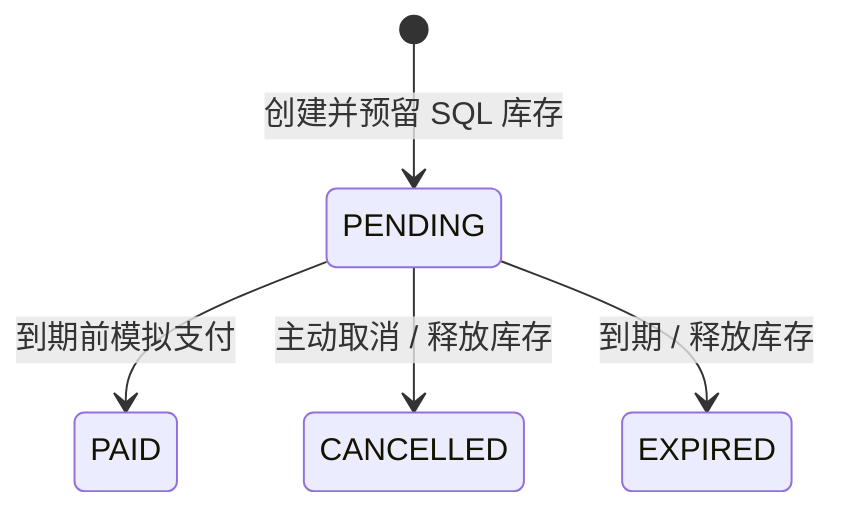

# 事务与故障边界

## 下单事务

1. HTTP 参数校验，Redis Lua 用户限流。
2. 锁定用户行，查同一用户的幂等 key。
3. 读取服务端价格，执行带 `stock>=quantity` 条件的原子扣减。
4. 插入订单和 Outbox 事件。
5. 同一个 SQL 事务提交。任一步失败均回滚库存和订单。

事务内不调用 Kafka 或外部支付接口，避免在热点库存锁下等待外部网络。订单金额不接受客户端传入。表结构也约束非负库存、正价格和有效状态。

## 状态机

状态转换锁订单行。支付、取消和过期任务竞争同一行，只有第一个合法转换改变库存。终态重复同一操作返回当前订单。过期任务每 15 秒扫描 100 笔；多个应用实例重复扫描安全，但这不是精确到毫秒的定时器。支付接口自身检查过期时间，避免扫描延迟允许超期付款。

## 事件投递

应用每秒锁定最多 10 条未发送 Outbox，`FOR UPDATE SKIP LOCKED` 避免实例重复处理同一批。等待 Kafka broker ACK 后，在同一数据库事务里更新 `published_at`。失败回滚整批，下轮重试；批内已经被 Kafka 接收的事件也可能重发。

消费者先将 event ID 与站内通知一起写入数据库，事务提交后才让监听容器提交 offset。event ID 是主键，重复消息不重复生成通知。非法消息和持续处理失败在重试后写入 `order-events.DLT`；DLT 发布失败会继续重试，不把消息直接丢弃。

消息按订单 ID 分区，但并行 Outbox 发布器可能改变同一订单事件的实际发送次序。本项目通知是独立事件记录，不依赖到达顺序，不在消费者中重建订单状态。如果要构建依赖顺序的投影，需要增加 aggregate version 并按版本校验/补偿。

## 故障行为

| 故障 | 行为 |
|---|---|
| 商品缓存不可用 | 回源 SQL，不影响库存判断 |
| Redis 限流不可用 | 新下单返回 503；查询订单、付款、取消仍可通过 SQL 执行 |
| MySQL 不可用 | 认证和业务无法继续，返回 503 |
| Kafka 不可用 | 已运行的应用继续受理订单，Outbox 积压，恢复后重试 |
| Kafka ACK 后应用崩溃 | SQL 未提交时可能重发，通知按 event ID 去重 |
| 消费者提交 DB 后崩溃 | offset 可能未提交，重放安全 |
| 多实例过期扫描竞争 | 锁订单行并重新检查状态，只释放一次库存 |

Kafka 不进入 readiness 检查，因为 Outbox 用于容忍 broker 短期中断。首次启动仍应等待 Kafka 可用，以完成 topic 初始化。Redis 进入 readiness，缓存可降级但下单限流不能。大量失败重试时仍需监控 Outbox 年龄和数量，不能无限容忍积压。

## 已知边界与后续练习

- 单个热点商品行会串行化扣库存；先测量，再考虑库存分桶、异步受理等演进。
- 同用户下单按用户行串行化，换取清晰的并发幂等语义。
- 用户、订单、Outbox、已过期 token 和通知尚无归档/清理任务；长期运行需要保留策略，清理幂等 key 时需定义重试窗口。
- 商品目录只读，演示数据由 Flyway 提供，没有管理员接口；引入价格修改后需明确价格版本和缓存失效策略。
- Outbox 对故障采用轮询重试；生产环境需要告警、退避、限额和故障隔离。
- 不支持退款、真实支付验签、跨服务 Saga；没有分库分表。
- 公开注册和登录没有防爆破机制。当前限流只保护已认证的下单接口。
- 新建 topic 的副本数是 1，适合单节点演示；生产需要结合 broker 数量调整副本、min ISR 和 ACL。

可以用这些边界作为下一阶段任务，而不是在第一版引入多个注册中心、数据库和消息系统。
