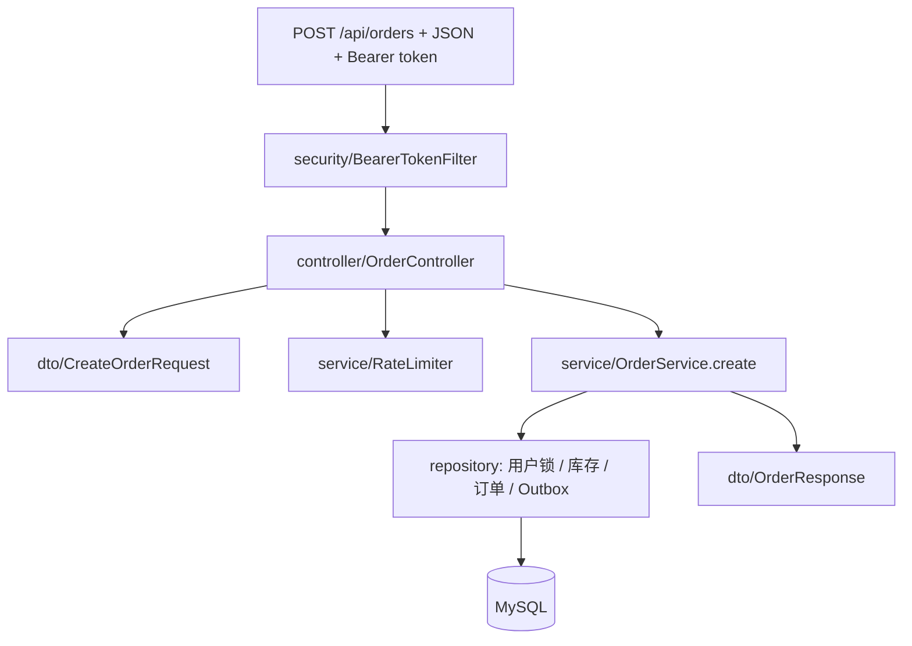

# 从哪里开始读代码

建议先跑通 `scripts/smoke.ps1`，看到一笔订单成功创建、支付、收到通知，再沿着下面的路径读代码。第一遍先理解 HTTP、业务和 SQL 三层，Redis、Kafka 和 Kubernetes 可以后读。

## 1. 找到启动入口和配置

源码根目录是 `src/main/java/dev/jzhope/flashsale/`。

- `FlashSaleApplication.java`：Spring Boot 启动入口，启用组件扫描和定时任务。
- `src/main/resources/application.yml`：数据库、Redis、Kafka、订单有效期等配置。
- `src/main/resources/db/migration/V1__schema.sql`：表、索引、外键和约束。

Spring 创建并连接这些对象，构造器参数就是它们的依赖。你不需要在 Controller 里手动 `new OrderService(...)`。

## 2. 跟着一次下单请求走

先读 `controller/OrderController.java` 的 `create` 方法：

1. `Principal` 来自认证过滤器，表示当前登录用户，不由 JSON 指定。
2. `@RequestHeader` 获取幂等 key；`@RequestBody` 把 JSON 解析成请求 DTO。
3. `@Valid` 检查 DTO 上的 `@Min`、`@Max` 等约束。
4. 调用限流器和 `OrderService`，将返回的内部订单转换成 `OrderResponse`。

Controller 不写 SQL，也不决定订单能否从已支付变成已取消。

接着读 `service/OrderService.java` 的 `create`：参数校验 → 锁用户行 → 查幂等记录 → 读取服务端价格 → 条件扣库存 → 保存订单 → 写入 Outbox。`@Transactional` 覆盖整个流程。出现异常时，订单、库存和事件会一起回滚。

最后读 `repository/AuthRepository.java`、`ProductRepository.java`、`OrderRepository.java`、`OutboxRepository.java`，把业务方法名和具体 SQL 对上。Repository 负责执行 SQL 和把查询结果映射为模型，不负责业务状态机。

## 3. 分清 DTO 和 Model

| 目录 | 用途 | 示例 |
|---|---|---|
| `dto/` | HTTP 请求和响应的公开形状 | `CreateOrderRequest`、`OrderResponse` |
| `model/` | 内部业务、数据库读取的数据 | `Order`、`Product`、`UserAccount` |
| `messaging/` | Kafka 上的消息契约 | `OrderEvent`、`OrderEventType` |

例如 `UserAccount` 包含密码摘要，只能留在内部；登录响应返回 `TokenResponse`。`OrderStatus` 是内部枚举，响应 DTO 显式转换成原有的状态字符串，避免内部重构意外改变 JSON。

本项目用 Java `record` 表示不可变的数据快照。它不是必须搭配 JPA 的 `@Entity`：这里使用 `JdbcTemplate` 和明确的 SQL，不通过 ORM 隐式生成查询。

## 4. 读状态机和事务

读 `OrderService.pay/cancel/expire`，再读它们调用的私有 `transition` 方法。这三个公开方法都有事务注解；Controller 和定时任务通过 Spring 代理调用它们，事务在私有方法开始前已经建立。

状态使用 `OrderStatus` 枚举，只有 `PENDING` 可以改变：支付不释放库存，取消和过期释放库存。状态转换先锁订单行，锁拿到后重新判断状态，因此两个请求不会各释放一次库存。支付接口自己判断到期时间，不依赖定时扫描是否准时执行。

配合阅读 `OrderServiceTest`：并发抢库存、同 key 重试、重复取消、过期支付，以及事件写入失败时状态和库存一起回滚。

## 5. 再读 Redis 和 Kafka

- `ProductService`：缓存商品元数据；缓存失效、损坏或 Redis 故障时从数据库读取。库存不能以缓存内容为准。
- `RateLimiter`：Lua 将计数递增和首次设置 TTL 合在一次原子执行中。它是固定窗口限流，不是平滑滑动窗口。
- `OrderEventWriter`：要求调用方已有数据库事务，并写入待发事件。
- `task/OutboxJob` → `messaging/OutboxPublisher`：定期领取事件，Kafka ACK 后标记已发。SQL 集中在 `OutboxRepository`。
- `NotificationConsumer` → `NotificationService` → `NotificationRepository`：解析事件，保存通知；event ID 唯一约束吸收重复消息。

Kafka ACK 后、SQL 提交前崩溃可能导致重发。先理解这一故障窗口，再看去重测试，就能理解为什么本项目使用“至少一次投递”，而没有宣称全局 exactly-once。

## 6. 改一个小功能练习

建议从“为本人订单增加一个查询条件”开始：

1. Controller 接收查询参数，不接受任意用户 ID 绕过身份校验。
2. Service 决定允许哪些过滤条件。
3. Repository 使用参数绑定执行 SQL，不拼接用户输入。
4. API 测试覆盖合法、非法和越权请求。
5. 运行 `mvnw.cmd spotless:apply`，再运行 `mvnw.cmd clean verify -Dintegration=true`。

移动或重命名 Java 类后使用 `clean`，避免旧的 `.class` 留在 `target/` 造成重复 Bean。四条 `ArchitectureTest` 规则会检查层间依赖；Checkstyle 检查 Java 结构，Spotless 负责格式。它们解决不同的问题，都不能替代业务测试。
